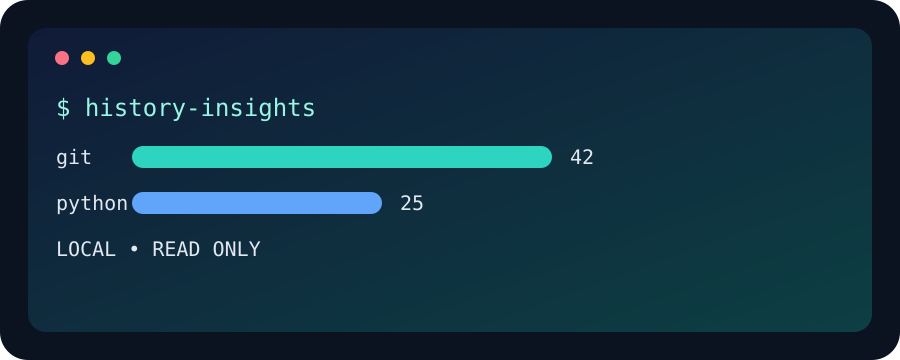

<div align="center">


[](LICENSE)
[](https://www.python.org/)
[](https://github.com/CyberLoop-dev/shell-history-insights/stargazers)
[](https://github.com/CyberLoop-dev/shell-history-insights/commits/main)

**A privacy-first report of the commands you use most.**



</div>

## 🧭 Overview

Read a local Bash or Zsh history file and summarize executable names and timestamped usage. The tool never executes commands, changes the history file, or prints arguments.

## ✨ Features

- 🔒 Local and read-only processing.
- 📊 Command counts without exposing arguments.
- 🕒 Usage-by-hour summaries when timestamps exist.
- 📄 Text, CSV, and JSON output.
- 🧰 Python standard library only.

## 🖥️ Demo

```bash
python main.py --file ~/.bash_history
```

Example format (your counts are computed from your own history):

```text
Shell History Insights
Commands analyzed: 128
Timestamp coverage: 71%
Top commands:
  1. git                42
  2. python             25
```

## 🚀 Quick Start

```bash
git clone https://github.com/CyberLoop-dev/shell-history-insights.git
cd shell-history-insights
python main.py --file ~/.bash_history
```

Use `--format json` or `--format csv` for machine-readable output.

## 🧱 Tech Stack

- 🐍 Python 3.10+
- 📦 argparse, csv, json, pathlib, shlex

## 🗂️ Folder Structure

```text
shell-history-insights/
├── assets/illustration.svg
├── tests/test_main.py
├── main.py
├── pyproject.toml
├── .gitignore
└── README.md
```

## 🛣️ Roadmap

- [x] Bash and Zsh timestamp parsing
- [x] Text, CSV, and JSON reports
- [ ] Additional shell history fixtures

## 🤝 Contributing

Pull requests are welcome. Keep processing local, read-only, and avoid exposing command arguments.

## 📄 License

MIT — see [LICENSE](LICENSE).

<div align="center"></div>